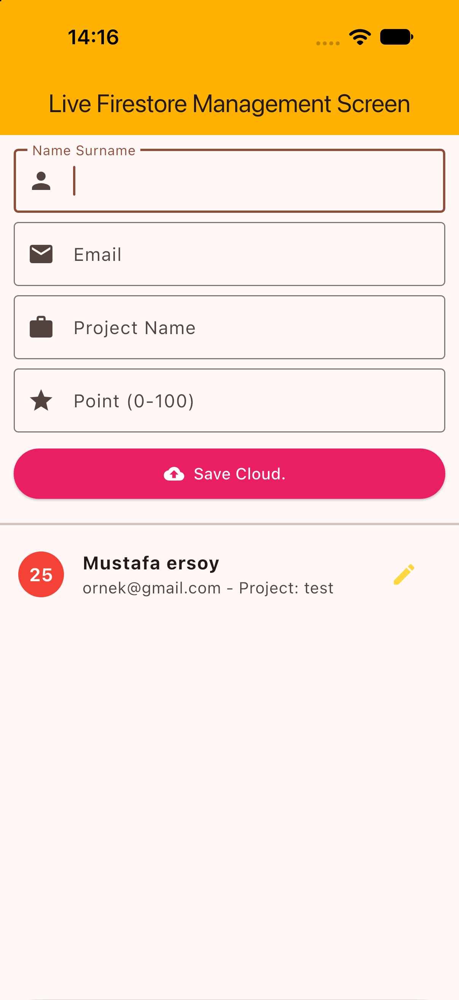
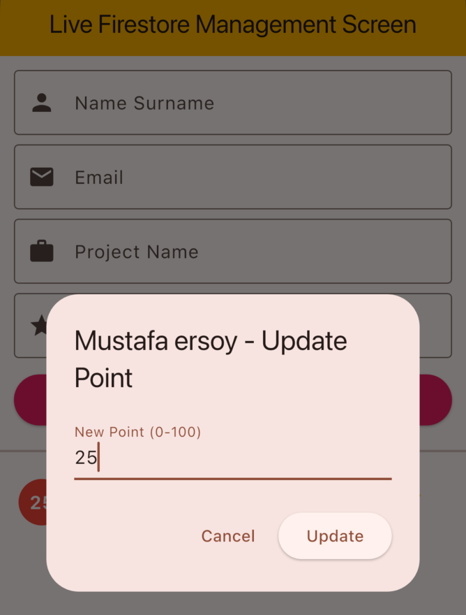
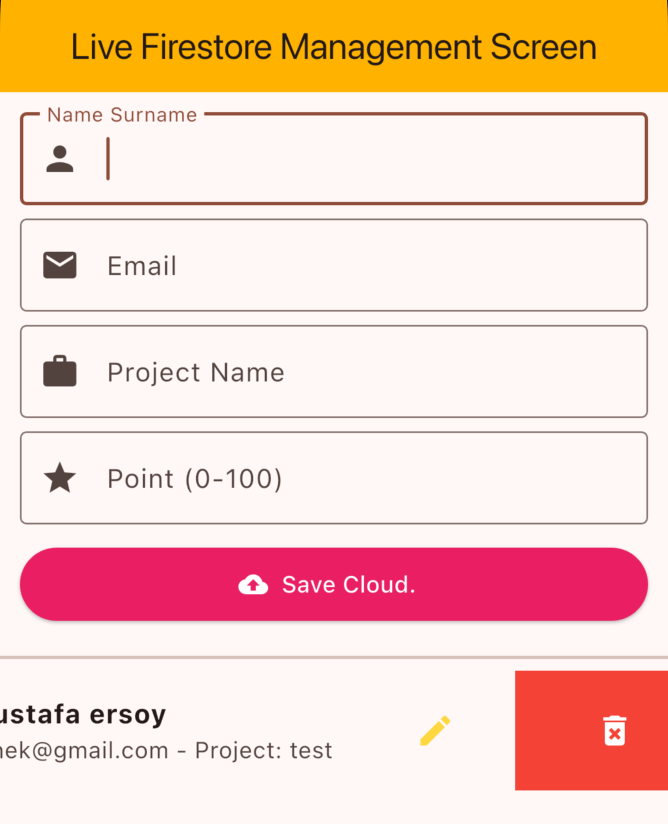

# _3_kasim

Öğrencilerin ad soyad, e-posta, proje adı ve puanını Firebase Cloud Firestore'da tutan küçük bir öğrenci yönetim uygulaması. Flutter ile yazıldı. Öğrenci ekleyebilir, puanını güncelleyebilir ya da silebilirsin; veriler `students` koleksiyonunda durur ve yapılan her değişiklik açık ekranlarda hemen görünür.

| Yönetim Ekranı | Puan Güncelleme | Silme |
| --- | --- | --- |
|  |  |  |
