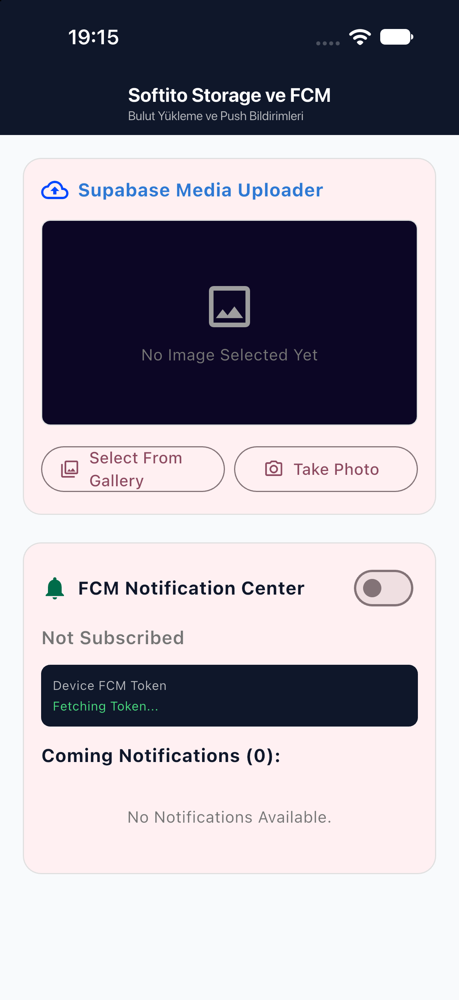

Görsel yükleme ve push bildirimlerini tek ekranda gösteren küçük bir demo. Flutter ile yazıldı. Görseller kameradan ya da galeriden seçilip Supabase Storage'daki `uploads` bucket'ına yüklenir ve herkese açık URL'i ekranda gösterilir. Bildirimler Firebase Cloud Messaging (FCM) ile gelir: cihaz token'ı ekranda görünür, `softito` topic'ine abone olunabilir ve foreground'da gelen mesajlar hem yerel bildirim olarak çıkar hem de listeye eklenir.

| Ana Ekran |
| --- |
|  |

| Bölüm | Servis | Ne yapar |
| --- | --- | --- |
| Görsel yükleme kartı | Supabase Storage | Kameradan veya galeriden görsel seçer, %70 kaliteyle 800px genişliğe sıkıştırıp `uploads/` klasörüne yükler, public URL'i gösterir |
| Bildirim kartı | Firebase Cloud Messaging | FCM token'ını gösterir, `softito` topic'ine abonelik açıp kapatır, gelen bildirimleri listeler |

Kurulum notları:
- Supabase URL ve publishable key [supabase_config.dart](lib/config/supabase_config.dart) içinde. Bucket ve upload policy'si `supabase/migrations/` altındaki SQL ile oluşturulur. Bucket herkese açıktır, 5 MiB sınırı vardır ve yalnızca `jpeg`, `png`, `webp` kabul eder. Uygulamada giriş olmadığı için anon kullanıcılara yalnızca INSERT izni verilir.
- Firebase ayarları `flutterfire configure` ile üretilen `lib/firebase_options.dart` dosyasındadır. Firebase başlatılamazsa hata konsola yazılır ve uygulama açılmaya devam eder.
- Foreground bildirimleri `flutter_local_notifications` ile gösterilir. Background mesajları için `fcmBackgroundHandler` kayıtlıdır, ancak içi boştur.
- Test bildirimi göndermek için konsola yazdırılan FCM token'ını ya da `softito` topic'ini Firebase konsolundaki Cloud Messaging bölümünde hedef olarak seç.
