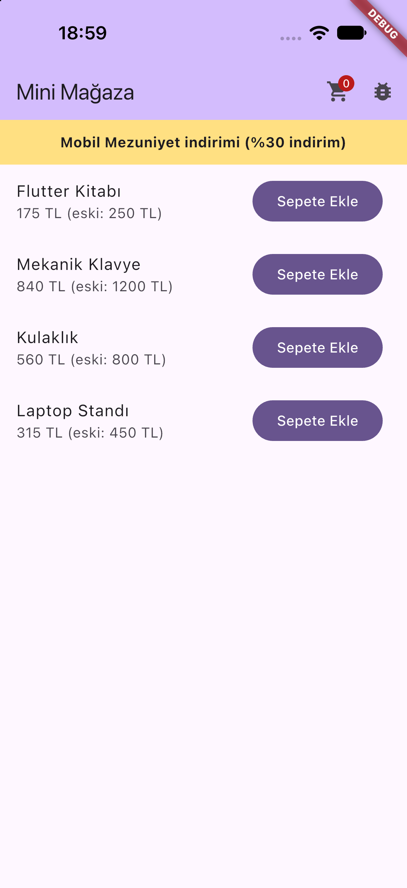

Firebase Analytics, Crashlytics ve Remote Config'i tek uygulamada gösteren küçük bir mağaza demosu. Flutter ile yazıldı. Kampanya banner'ı, indirim oranı ve zorunlu güncelleme ekranı Remote Config'ten gelir; "Sepete Ekle" ve ekran görüntüleme olayları Analytics'e gider; Debug ekranından log, sessiz hata ve çökme testi Crashlytics'e gönderilebilir.

| Ana Ekran |
| --- |
|  |

| Ekran | Servis | Ne yapar |
| --- | --- | --- |
| Ana ekran | Remote Config, Analytics | Kampanya banner'ını ve indirimli fiyatları gösterir, `sepete_eklendi` olayını gönderir |
| Debug ekranı | Remote Config, Crashlytics | Güncel Remote Config değerlerini listeler, log ekler, sessiz hata kaydeder, çökme testi yapar |
| Güncelleme ekranı | Remote Config, Analytics | `zorunlu_guncelleme` açık ve sürüm `en_dusuk_surum` değerinden düşükse tüm uygulamayı kaplar |

Remote Config parametreleri: `kampanya_aktif`, `kampanya_metni`, `kampanya_indirim_orani`, `zorunlu_guncelleme`, `en_dusuk_surum`. Konsolda tanımlı değilse koddaki varsayılanlar kullanılır.
